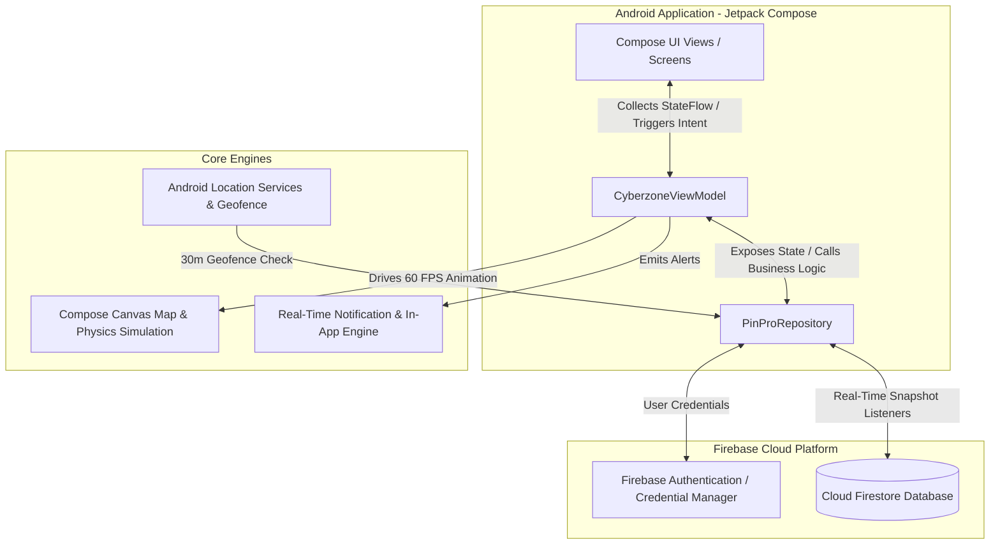
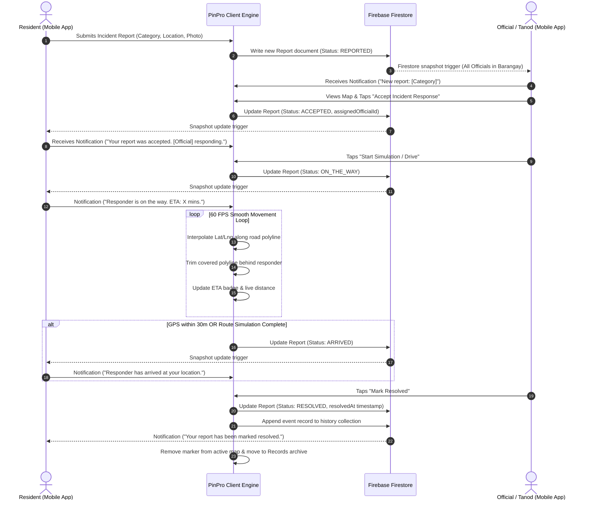

# PinPro System Architecture & Design

This document details the software architecture, state management patterns, UI structure, and lifecycle flow of the PinPro application.

---

## 🏗️ High-Level System Architecture

PinPro is structured following **Clean Architecture** principles and the **Model-View-ViewModel (MVVM)** pattern with reactive data streams powered by Kotlin `StateFlow`.

---

## 🔄 Incident Report Lifecycle Sequence Diagram

The diagram below describes the end-to-end lifecycle of an incident report, from resident submission to official response, live route tracking, auto-arrival, and final resolution archiving.

---

## 📱 Component & Screen Breakdown

### 1. Main Navigation Container (`CyberzoneMainDashboard.kt`)
- Handles safe-area top inset padding (`env(safe-area-inset-top)`) and bottom navigation routing.
- Holds top app bar header, notifications tray modal, and active bottom navigation bar (Home, Map, Reports, Records, Profile).

### 2. Map Screen (`CyberzoneMapView.kt` & `BalangaGoogleMapCanvas.kt`)
- **Single-Row Compact Header**: 56px max height pinned to the top edge of the map containing Logo + "PinPro", notifications bell icon, "All Reports" filter, and map style dropdown (Streets, Satellite, Dark).
- **Interactive Canvas Map**: Hardware-accelerated Custom Canvas map centered on Brgy. Poblacion, Balanga City, Bataan (`14.6763, 120.5361`).
- **Expandable Bottom Sheet**: Draggable panel supporting:
  - **Collapsed State (100–130px / 35dvh max)**: Status badge, report title, ETA badge, and primary action button (Accept, Start Simulation, Mark Resolved).
  - **Expanded State (60dvh max)**: Detailed report description, full address, status timeline history, responder info, and simulation speed toggle (1x, 2x, 4x).

### 3. Incident Reports & Submission (`CyberzoneOtherTabs.kt`)
- **Submit Report Tab**: Category picker (Medical, Fire, Fights, Flood, Complaint), interactive location picker dialog (`GoogleMapsLocationPickerScreen.kt`), photo upload placeholder, description input.
- **Reports List Tab**: Categorized tabbed list (All, Pending, Responding, Resolved) with search filtering and direct map focus buttons.
- **Records Tab**: Searchable archive of completed/resolved incidents with resolution timestamps and responder details.
- **Profile & Role Switcher**: User profile summary, barangay assignment, notification settings, and 1-click test role switcher (Resident vs Official).

---

## ⚡ State Management Pattern

The application leverages `CyberzoneViewModel` to expose reactive states using `StateFlow`:

- **`activeReports: StateFlow<List<Report>>`**: Live list of active, non-resolved reports in the current barangay.
- **`selectedReport: StateFlow<Report?>`**: Currently focused report on the map or tracking sheet.
- **`officialLocation: StateFlow<LatLng>`**: Real-time GPS or interpolated coordinate of the responder.
- **`simulationState: StateFlow<SimulationState>`**: Holds current frame step, speed multiplier (1x, 2x, 4x), remaining route polylines, current ETA, and target arrival state.
- **`notifications: StateFlow<List<AppNotification>>`**: In-app notification queue rendered in the top notification tray.

---

## 🔐 User Roles & Role Switcher

- **Resident Role**: Focused on ease of submission and clear tracking. Cannot accept reports or trigger simulation controls.
- **Barangay Official / Tanod Role**: Accesses responder dispatch tools, simulation controls, route preview, auto-arrival detection, and resolution actions.
- **Role Switcher**: Accessible via the Profile tab and floating test menu, allowing instant switching between Resident and Official roles during testing without requiring account re-authentication.
